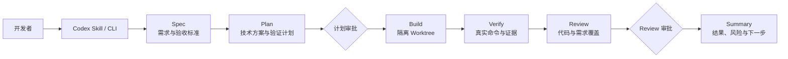

# BossFlow

[](https://github.com/61joe/bossflow/actions/workflows/ci.yml)
[](https://github.com/61joe/bossflow/releases)


> 把 AI 编程从一次性聊天，变成可审批、可验证、可恢复的开发流程。

BossFlow 是面向个人开发者的 AI 开发编排层。它在 Codex 等 Coding Agent 之上增加需求规格、
技术计划、实现隔离、真实验证、独立 Review 和人工审批，让一次开发任务不再只依赖聊天上下文。

BossFlow 不替代 Codex，也不训练或代理具体模型。它负责定义流程、角色边界、产物契约和证据，
并将代码实现交给可替换的 Coding Agent Adapter。

## BossFlow 能做什么

| 能力                      | 说明                                                                                         |
| ------------------------- | -------------------------------------------------------------------------------------------- |
| 受控开发流程              | 将任务拆分为 Spec → Plan → Build → Verify → Review → Summary，并在关键节点停止等待人工审批。 |
| 可恢复的运行记录          | 将规格、计划、实现、验证、Review 和摘要写入 `.bossflow/runs/<run-id>/`，进程中断后可以恢复。 |
| 隔离代码实现              | 默认拒绝脏工作区，并在独立 Git Worktree 中执行实现，避免污染主工作区。                       |
| 真实验证证据              | 直接执行项目确认的 lint、typecheck、test 和 build，保存退出码、耗时和脱敏后的输出。          |
| 需求覆盖检查              | 将验收标准映射到代码改动和验证证据，未覆盖项会进入 Review，而不是由模型自行宣称完成。        |
| 明确的外部操作授权        | 审批 Plan 和 Review 后，仍需显式授权 commit、push、merge 或 pr；批准不会自动执行这些动作。   |
| 多模型档案                | 支持 OpenAI 和 OpenAI-compatible Endpoint，并允许不同项目使用各自的模型与凭据。              |
| Coding Agent 可替换边界   | Core 不依赖 Codex；当前提供 Codex Adapter，后续可增加其他 Coding Agent 实现。                |
| Codex Desktop 与 CLI 入口 | 可安装项目级 `$bossflow` Skill，也可通过受控 CLI 工作流运行。                                |

## 工作流程



核心约束：

- 没有有效的 Plan approval，不会进入 Build。
- Verification 命令由项目 profile 决定，Plan 中的建议不会隐式扩大执行权限。
- P0/P1 Review finding 或缺失的必需验证证据会阻断流程。
- commit、push、merge 和 PR 需要单独的外部操作授权。

## 环境要求

| 依赖    | 要求                                                |
| ------- | --------------------------------------------------- |
| Node.js | `24+`                                               |
| pnpm    | `12+`                                               |
| Git     | 支持 Worktree 的现代版本                            |
| Codex   | 使用 Codex Adapter 执行 Build 时需要 CLI 与有效认证 |

## 安装

BossFlow 当前处于 MVP 阶段，包仍是 `private`，尚未发布到 npm。请从源码构建：

```bash
git clone https://github.com/61joe/bossflow.git
cd bossflow
pnpm install
pnpm build
node packages/cli/dist/bin.js --help
```

为了便于后续示例阅读，可以为构建产物创建本地别名：

```bash
alias bossflow="node /absolute/path/to/bossflow/packages/cli/dist/bin.js"
```

Windows 或不使用 shell alias 时，将示例中的 `bossflow` 替换为
`node /absolute/path/to/bossflow/packages/cli/dist/bin.js`。

## 快速开始

### 方式一：在 Codex Desktop 中使用 `$bossflow`

1. 将项目级 Skill 安装到目标仓库：

   ```bash
   bossflow adapter install codex --project /path/to/your-project
   ```

2. 初始化该项目的 BossFlow 配置：

   ```bash
   cd /path/to/your-project
   bossflow init
   bossflow doctor
   ```

3. 配置推理模型和凭据。默认 OpenAI profile 可从环境变量读取 `OPENAI_API_KEY`：

   ```bash
   bossflow auth set openai
   ```

4. 在 Codex Desktop 中打开目标仓库，新建聊天并输入：

   ```text
   $bossflow 为项目增加 CSV 导出功能
   ```

5. 检查 Specification 与 Technical Plan，确认后继续 Build、Verify 和 Review。

### 方式二：使用 CLI 受控工作流

```bash
cd /path/to/your-project
bossflow init
bossflow doctor
bossflow run "为项目增加 CSV 导出功能" --confirm-project
```

`run` 默认生成 Specification 和 Technical Plan，然后停在计划审批门禁。查看运行 ID 和当前状态：

```bash
bossflow status <run-id>
```

审批计划并继续执行：

```bash
bossflow approve <run-id> --gate plan
bossflow resume <run-id>
```

Verification 和 Review 通过后，再决定是否授权外部操作：

```bash
bossflow approve <run-id> --gate review --action commit --action pr
```

## CLI 命令

所有命令均支持 `bossflow <command> --help` 和 `bossflow --version`。

### 命令总览

| 命令                                      | 作用                                                 |
| ----------------------------------------- | ---------------------------------------------------- |
| `bossflow doctor`                         | 检查 Node.js、项目配置、当前模型档案和凭据来源。     |
| `bossflow init`                           | 在当前项目创建 `.bossflow/config.yaml`。             |
| `bossflow run <goal>`                     | 创建 Run，生成 Specification 和 Technical Plan。     |
| `bossflow status <run-id>`                | 查看阶段、审批、产物、验证和 Review 状态。           |
| `bossflow approve <run-id> --gate <gate>` | 审批 Plan 或 Review，并记录授权动作。                |
| `bossflow resume <run-id>`                | 从第一个未完成阶段恢复，不绕过人工门禁。             |
| `bossflow adapter install <adapter>`      | 安装目标项目的 Coding Agent 集成，目前支持 `codex`。 |
| `bossflow model list`                     | 列出模型档案，`*` 表示默认档案。                     |
| `bossflow model add <name>`               | 新增或替换模型档案。                                 |
| `bossflow model use <name>`               | 切换默认模型档案。                                   |
| `bossflow model remove <name>`            | 删除非默认模型档案及其本地凭据。                     |
| `bossflow model test <name>`              | 发起最小真实调用，验证模型、Endpoint 和结构化输出。  |
| `bossflow auth set <profile>`             | 使用隐藏输入写入本地凭据。                           |
| `bossflow auth status`                    | 查看每个模型档案的凭据来源，不显示密钥。             |
| `bossflow auth clear <profile>`           | 删除某个档案的本地凭据。                             |

### `bossflow run`

| 参数或选项            | 必需 | 说明                                                           |
| --------------------- | ---- | -------------------------------------------------------------- |
| `<goal>`              | 是   | 本次开发目标。                                                 |
| `--profile <profile>` | 否   | 使用指定模型档案，覆盖项目默认档案。                           |
| `--model <model>`     | 否   | 仅为当前 Run 覆盖推理模型标识。                                |
| `--confirm-project`   | 否   | 接受自动识别的项目验证命令；存在歧义时必须显式确认后才能运行。 |
| `--stop-after spec`   | 否   | 只生成 Specification；当前仅支持 `spec`。                      |

`--profile` 和 `--model` 只控制 Specification、Plan、Review 和 Summary 使用的推理模型，
不会透传给 Codex Build 阶段。Codex CLI 使用其自身配置的模型和认证。

### `bossflow approve`

| 参数或选项          | 必需 | 说明                                                       |
| ------------------- | ---- | ---------------------------------------------------------- |
| `<run-id>`          | 是   | 要审批的 Run ID。                                          |
| `--gate <gate>`     | 是   | 审批门禁，取值为 `plan` 或 `review`。                      |
| `--action <action>` | 否   | 允许 `commit`、`push`、`merge`、`pr`；可重复传入多个动作。 |
| `--actor <actor>`   | 否   | 审批人标识，写入运行记录。                                 |
| `--note <note>`     | 否   | 审批说明，写入运行记录。                                   |

审批只记录授权，不会自动执行 Git 或 GitHub 操作。

### `bossflow adapter install`

| 参数或选项         | 必需 | 说明                                   |
| ------------------ | ---- | -------------------------------------- |
| `<adapter>`        | 是   | Adapter 标识，目前仅支持 `codex`。     |
| `--project <path>` | 否   | 目标项目根目录，默认当前目录。         |
| `--overwrite`      | 否   | 在明确确认后覆盖内容不同的同名 Skill。 |

Skill 会安装到目标项目的 `.agents/skills/bossflow/SKILL.md`。相同内容的重复安装是幂等的。

### `bossflow model add`

| 参数或选项             | 必需   | 说明                                                             |
| ---------------------- | ------ | ---------------------------------------------------------------- |
| `<name>`               | 是     | 模型档案名称。                                                   |
| `--kind <kind>`        | 否     | `openai` 或 `openai-compatible`，默认 `openai`。                 |
| `--model <model>`      | 视情况 | Provider 模型标识；`openai-compatible` 必填。                    |
| `--base-url <url>`     | 视情况 | API Endpoint；`openai-compatible` 必填。远程地址必须使用 HTTPS。 |
| `--api-key-env <name>` | 否     | 保存 API Key 的环境变量名，不接收密钥值。                        |
| `--chat-completions`   | 否     | OpenAI profile 改用 Chat Completions，而不是 Responses API。     |
| `--default`            | 否     | 将新档案设为项目默认模型。                                       |

### `bossflow auth set`

| 参数或选项  | 必需 | 说明                                               |
| ----------- | ---- | -------------------------------------------------- |
| `<profile>` | 是   | 模型档案名称。                                     |
| `--stdin`   | 否   | 从重定向输入或管道读取密钥；交互终端中不允许使用。 |

API Key 不支持通过命令行值传入，以免进入 Shell 历史和进程参数。

## 模型配置

项目配置位于 `.bossflow/config.yaml`。一个 OpenAI-compatible 模型档案示例：

```yaml
schemaVersion: 1
workflow:
  initialStage: spec
  runDirectory: .bossflow/runs
  verification:
    requiredCommands:
      - lint
      - typecheck
      - test
      - build
    defaultTimeoutMs: 120000
    commandOverrides: {}
models:
  defaultProfile: local
  profiles:
    local:
      kind: openai-compatible
      model: coding-model
      baseUrl: http://localhost:11434/v1
      apiKeyEnv: LOCAL_MODEL_API_KEY
```

凭据解析顺序：

1. 模型档案指定的环境变量。
2. `.bossflow/credentials.local.yaml` 中的本地凭据。
3. 返回 missing 并拒绝调用模型。

`.env` 和 `.bossflow/credentials.local.yaml` 都不得提交到 Git。本地凭据文件权限固定为 `0600`，
但仍是个人开发环境中的明文存储，不等同于系统级密钥保险箱。

完整的安全规则和 Provider 兼容策略见 [模型配置与凭据管理](docs/MODEL_CONFIGURATION.md)。

## 运行产物

BossFlow 将关键状态和证据写入项目目录：

```text
.bossflow/
├── config.yaml
├── credentials.local.yaml     # 本地凭据，Git 忽略
└── runs/
    └── <run-id>/
        ├── run.json
        ├── spec.md
        ├── plan.json
        ├── implementation.json
        ├── implementation.patch
        ├── verification.json
        ├── review.json
        └── summary.md
```

Artifact 带有 SHA-256 校验；被修改的产物不会用于恢复。输出在持久化前会进行敏感信息脱敏。

## 项目结构

| 路径                | 说明                                                                          |
| ------------------- | ----------------------------------------------------------------------------- |
| `packages/core`     | 工作流状态机、Agent、契约、Run Store、Verification、Review 和 Worktree 管理。 |
| `packages/adapters` | Coding Agent Adapter 边界与 Codex Skill 安装能力。                            |
| `packages/cli`      | `bossflow` 命令、参数解析、模型/凭据管理和工作流组合。                        |
| `openspec/specs`    | 已生效的行为契约。                                                            |
| `openspec/changes`  | 进行中的 OpenSpec 变更与已归档历史。                                          |
| `docs`              | 产品、配置、架构、测试、贡献和发布文档。                                      |
| `tests/integration` | 跨包集成测试，不访问真实模型或网络。                                          |

依赖方向保持单向：

```text
CLI ──→ Adapters ──→ Core
 └──────────────────→ Core
```

## 常用开发命令

```bash
pnpm dev                 # 构建后运行 CLI
pnpm check               # 完整质量门禁
pnpm test                # Jest + 100% coverage
pnpm smoke:model         # 真实模型人工 smoke，不进入 CI
pnpm conformance:codex   # 真实 Codex 一致性验证
pnpm spec:list           # 列出 OpenSpec 变更
pnpm spec:validate       # 严格校验 OpenSpec
```

提交前必须通过：

```bash
pnpm format:check
pnpm lint
pnpm typecheck
pnpm test
pnpm build
pnpm spec:validate
```

## 文档

| 文档                                                           | 内容                                          |
| -------------------------------------------------------------- | --------------------------------------------- |
| [产品需求](docs/PRD.md)                                        | 产品背景、目标、范围、角色和技术分层架构。    |
| [技术选型](docs/TECH_STACK.md)                                 | 运行时、开发工具、依赖边界和技术决策。        |
| [CLI 受控工作流](docs/CLI_WORKFLOW.md)                         | 命令流程、审批门禁、恢复和退出码。            |
| [模型配置与凭据管理](docs/MODEL_CONFIGURATION.md)              | 模型档案、OpenAI-compatible Provider 和密钥。 |
| [项目上下文与验证命令](docs/PROJECT_CONTEXT.md)                | 项目检测、验证命令和覆盖配置。                |
| [Worktree 与实现阶段](docs/WORKTREE_IMPLEMENTATION.md)         | 隔离实现、Diff 证据、恢复和清理。             |
| [Verification、Review 与 Summary](docs/VERIFICATION_REVIEW.md) | 验证、审查、需求覆盖和摘要产物。              |
| [测试策略](docs/TEST_STRATEGY.md)                              | 单元、集成、真实模型和 Codex 一致性测试。     |
| [TypeScript 代码规范](docs/TS_STYLE_GUIDE.md)                  | 类型、模块、安全、测试和格式规则。            |
| [贡献指南](docs/CONTRIBUTING.md)                               | 分支、PR、Git Hook、CI 和 OpenSpec 流程。     |
| [发布流程](docs/RELEASE.md)                                    | Changesets、Release PR 和 GitHub Release。    |

## FAQ

### BossFlow 是模型或 Agent 框架吗？

不是。BossFlow 使用 `@openai/agents` 构建角色化推理能力，但产品价值在于开发流程、审批边界、
运行记录和证据协议，而不是重新实现一个通用 Agent SDK。

### BossFlow 会替代 Codex 吗？

不会。Codex Desktop 仍是主要交互入口，Codex CLI 是当前 Build 阶段的 Coding Agent。
BossFlow 负责在它的外层控制阶段、权限、验证和恢复。

### 为什么 Plan 审批后还要 Review 审批？

Plan 审批确认实现范围和方案；Review 审批确认实际代码、测试证据和剩余风险。两者对应不同的
人工决策，不能互相替代。

### 支持 DeepSeek 吗？

可以通过 `openai-compatible` profile 使用 Chat Completions 兼容 Endpoint。Build 阶段实际使用的模型
仍由 Codex CLI 管理，不受 BossFlow 推理模型档案控制。

### 可以直接发布到 npm 吗？

当前不能。所有 workspace package 仍为 `private: true`，npm Registry 发布尚未启用。具体待办见
[TODO.md](TODO.md)。

## 贡献

所有代码修改必须使用 `feat-`、`fix-` 或 `chore-` 分支，通过 Pull Request 合并到 `main`。
不要直接提交或推送 `main`。完整流程见 [贡献指南](docs/CONTRIBUTING.md)，发布步骤见
[发布流程](docs/RELEASE.md)。

## License

项目许可证尚未最终确定。在 LICENSE 文件正式加入前，不应假定代码具备可再分发或商业使用授权。
