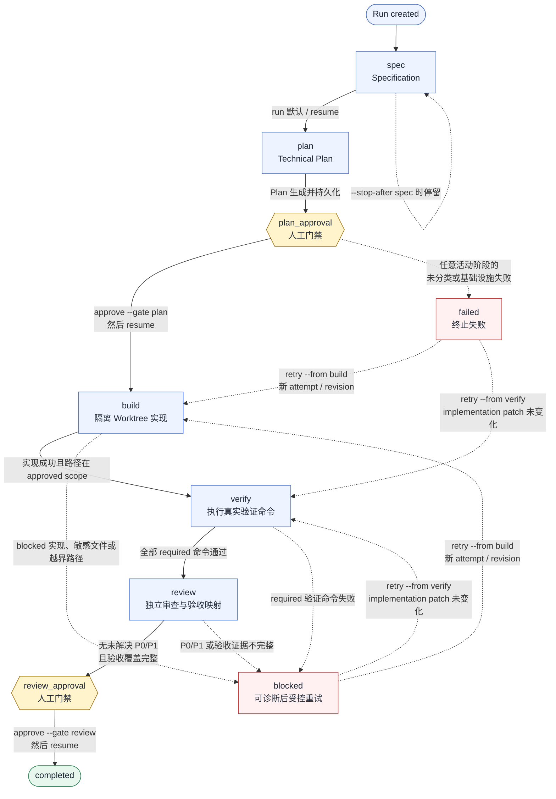

# CLI 受控工作流

## 安装 Codex Skill

在当前项目安装 `$bossflow` Skill：

```text
bossflow adapter install codex
```

安装到指定项目：

```text
bossflow adapter install codex --project /path/to/project
```

目标路径为 `.agents/skills/bossflow/SKILL.md`。重复安装相同版本是幂等的；如果同名文件不同，命令返回退出码 `8` 且不覆盖。用户检查后可使用 `--overwrite` 显式替换。

## 启动运行

默认 `run` 会生成 Specification 和 Technical Plan，然后停在计划审批门禁：

```text
bossflow run "增加导出功能" --confirm-project
```

只生成 Specification 时使用：

```text
bossflow run "增加导出功能" --confirm-project --stop-after spec
```

运行产物位于 `.bossflow/runs/<run-id>/`。计划审批前不会创建实现 Worktree。

进入计划审批前，`run` 会显示一次本地 Build readiness 快照。也可以单独执行：

```text
bossflow doctor --run
```

检查项包括 Node.js、配置、凭据来源、Git 工作区、包管理元数据和默认 Worktree 根目录。该预检
不会创建 Worktree 根目录，也不会调用模型网络端点；模型连通性应使用
`bossflow model test <profile>` 单独验证。存在未通过项时，`doctor --run` 返回非零并列出修复建议。

## 查看状态

```text
bossflow status <run-id>
```

状态输出包含当前阶段、审批记录、artifact 路径、验证状态、Review 未决项和下一步命令。
artifact 内容读取后会校验 SHA-256，被修改的产物不会用于恢复。

## 审批门禁

批准当前 Specification 与 Plan revision：

```text
bossflow approve <run-id> --gate plan
```

如果 Plan 中有需要额外执行的浏览器或集成检查，可以在批准 Plan 时显式采纳其命令 ID：

```text
bossflow approve <run-id> --gate plan --verification test:browser
```

`--verification` 可以重复。系统只接受当前 `plan.json` 中存在的命令，并把命令定义和 Plan
artifact 哈希一起记录到 approval。未采纳的 Plan 命令仍为 advisory，不会被执行。

Review 通过后，可以使用重复的 `--action` 仅授权明确请求的外部动作：

```text
bossflow approve <run-id> --gate review --action commit --action pr
```

允许的动作只有 `commit`、`push`、`merge` 和 `pr`。审批不会自动执行这些动作。
`--actor` 与 `--note` 可选，用于记录审批人和说明。

## 恢复运行

```text
bossflow resume <run-id>
```

恢复从第一个未完成阶段开始：

1. `spec`：生成 Plan 并停在 `plan_approval`。
2. `plan_approval`：没有有效 Plan approval 时拒绝进入 Build。
3. `build`：通过隔离 Worktree 中的 Codex Coding Agent 执行实现。此阶段使用 Codex CLI
   自身配置的模型和认证，不使用 BossFlow 的推理模型档案。
4. `verify`：执行项目确认的验证命令。
5. `review`：执行独立 Review 并生成 Summary。
6. `review_approval`：没有 Review approval 时不会标记完成。

已完成的 artifact 和阶段不会重复执行。`blocked` 与 `failed` 运行必须通过状态和证据定位原因，
不会被恢复命令静默绕过。

## Workflow 状态机

下图展示当前用户可见的正常阶段推进、阻断结果和受控 Retry 入口。实线表示正常推进，
虚线表示阻断或受控重开；六边形节点为人工审批门禁。



状态边界：

- `run --stop-after spec` 只停留在 `spec`；默认 `run` 会生成 `spec`、`plan` 并停在
  `plan_approval`。
- `plan_approval` 和 `review_approval` 缺少当前 revision 的有效 approval 时，CLI 返回门禁错误，
  Run 保持原阶段。
- `blocked` 表示存在可定位的实现、验证或 Review 阻断；只有新的 Build/Verify Retry 能重新打开。
- Retry 会在单个 Run 锁内归档旧证据、递增 `attempt` 和 `workflowRevision`，再进入选定的
  `build` 或 `verify`。
- `failed` 表示终止型失败；同样必须通过显式 Retry 创建新 attempt，`resume` 不会静默恢复。
- Core 通用 transition 表还保留少量非 CLI 主路径转换；公开 CLI 当前只提供
  `blocked/failed → build|verify` 的受控 Retry 入口。

## 重试阻塞运行

`resume` 不会重新打开 terminal Run。修正原因后使用显式重试：

```text
bossflow retry <run-id> --from build
bossflow retry <run-id> --from verify
```

两种入口都会递增 attempt 和 workflow revision，并在覆盖固定 artifact 文件名前，将旧实现、
Verification、Review 和 Summary 归档为 `attempt-<n>-*`。

Retry 的准备阶段由 Run Store 单锁完成：重新校验 stage、attempt、workflow revision 和更新
时间，归档证据、切换到目标阶段并写入新 attempt。并发重试只有一个请求能够取得 claim，失败
请求不会修改 Run。

选择规则：

- 代码或测试需要变化时使用 `--from build`。系统要求当前 Plan approval、Run 自有 Worktree 和
  未变化的主仓库基线；越界路径仍会阻断。
- 只需重新执行验证或 Review 时使用 `--from verify`。系统要求 Worktree 当前 Diff 与最近一次
  被接受的 implementation patch 完全一致；代码变化会要求改从 Build 重试。
- Plan 中发现额外的可执行检查时，可以重复传入 `--verification <id>`。命令必须存在于当前
  Plan，未选择的 Plan 命令仍为 advisory。
- 重试不会创建 `external-action` approval，也不会授权 commit、push、merge 或 PR。新的 Review
  通过后仍需单独执行 Review approval。

## 退出码

| 退出码 | 含义                               |
| ------ | ---------------------------------- |
| `0`    | 命令成功或按预期停在人工门禁       |
| `1`    | 未分类的运行时错误                 |
| `2`    | CLI 参数或用法错误                 |
| `3`    | Run 不存在或 Run ID 无效           |
| `4`    | 当前门禁未批准或阶段不允许该操作   |
| `5`    | Run 被验证、Review 或实现结果阻断  |
| `6`    | Run 失败或 artifact 完整性校验失败 |
| `7`    | 缺少当前阶段必需的 artifact        |
| `8`    | Adapter Skill 安装发生同名冲突     |

错误输出会附带可执行的恢复命令，例如补做审批或运行 `bossflow status` 查看证据。
