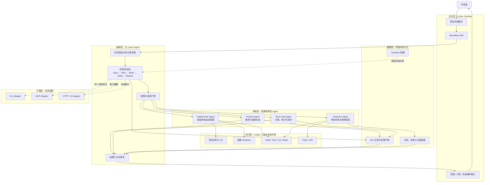

# BossFlow 项目初始化 PRD

| 项目     | 内容                                        |
| -------- | ------------------------------------------- |
| 产品名称 | BossFlow                                    |
| 文档类型 | 项目初始化 PRD                              |
| 文档版本 | v0.1                                        |
| 项目阶段 | MVP 定义与骨架初始化                        |
| 创建日期 | 2026-10-30                                  |
| 目标用户 | 使用 Codex Desktop 进行日常开发的个人开发者 |

## 1. 需求背景

### 1.1 当前问题

在使用 AI 编程工具完成一个开发任务时，开发者通常需要手动扮演或协调多个角色：

- 产品经理负责澄清问题、用户价值、范围和验收标准。
- 技术负责人负责影响分析、任务拆分、接口约定和测试策略。
- 前端或后端开发者负责按计划实施改动。
- 测试与审查者负责执行验证、检查回归风险并核对需求一致性。

当前这些工作大多依赖开发者在同一个聊天中反复切换提示词，容易产生以下问题：

1. **过程不可见**：需求、计划、实现和审查混在聊天记录里，难以复核和恢复。
2. **职责边界模糊**：不同角色共享同一段上下文，容易重复分析、遗漏约束或越权修改。
3. **流程依赖模型自觉**：阶段顺序、审批点和失败处理没有稳定约束，自动化程度提高后风险也随之增加。
4. **结果缺乏证据**：代码改动、测试结果、需求映射和审查结论没有形成统一交付物。
5. **个人经验难复用**：每个人、每个项目都在重新组织角色和提示词，无法沉淀为稳定工作流。

### 1.2 已讨论的产品方向

前序方案评估确认了两个核心判断：

- OpenAI Agents SDK 可以实现角色化 Agent、工具调用、结构化输出和编排，但它本身不是完整的开发工作流产品。
- MCP 适合把能力暴露给 Codex、Cursor 等客户端，但不应由 MCP 承担完整业务流程、状态持久化和审批控制。

BossFlow 的第一阶段优先采用 Codex-native 方案：

- 用户在 Codex Desktop 中打开目标项目并创建新聊天。
- 通过项目级 Skill `$bossflow` 唤起编排流程。
- 主 Codex Agent 承担编排职责，并按任务动态启用产品、架构、实现和审查角色。
- 角色定义和项目约束保存在仓库内，使流程可追踪、可复制、可逐步演进。
- 独立 SDK、CLI 和 MCP Adapter 作为后续能力，而不是 MVP 的前置条件。

### 1.3 机会

将 BossFlow 做成“项目内可唤起的开发编排层”，可以让开发者保留 Codex Desktop 的原生交互体验，同时获得：

- 更清晰的角色分工和阶段交付物。
- 更稳定的人工审批与权限边界。
- 可恢复、可审查的运行记录。
- 可跨项目复用的个人开发方法论。
- 为未来 CLI、MCP 或团队平台复用同一套流程定义和产物协议。

## 2. 需求描述

### 2.1 产品定位

BossFlow 是面向个人开发者的 AI 开发编排层。它不替代 Codex 或具体编程模型，而是在 Codex 之上增加：

- 明确的开发阶段。
- 角色化 Agent 职责。
- 结构化中间产物。
- 工具与文件权限边界。
- 人工审批节点。
- 可追溯的验证证据。

### 2.2 核心用户旅程

1. 用户在 Codex Desktop 中打开任意项目仓库。
2. 用户在该项目下创建新聊天。
3. 用户输入 `$bossflow <目标或任务>`。
4. BossFlow 读取当前仓库状态、技术栈和项目约束。
5. BossFlow 创建一次运行记录，并生成或更新需求规格。
6. 主 Agent 调用技术负责人能力，形成任务拆分、风险与验证计划。
7. 用户确认范围与计划后，BossFlow 调度实现角色完成任务。
8. 测试、静态检查和代码审查并行或串行执行。
9. BossFlow 汇总 Diff、测试证据、未解决问题和下一步建议。
10. 用户在明确确认后才允许提交、合并或创建 PR。

### 2.3 MVP 范围

#### P0：项目级唤起与初始化

- 提供可复用的 `$bossflow` Skill 入口。
- 支持在 Codex Desktop 新聊天中通过自然语言或显式 Skill 名唤起。
- 自动识别当前项目根目录、Git 状态和关键工程文件。
- 支持空仓库初始化与已有仓库接入。
- 在修改代码前向用户展示识别结果和拟执行流程。

#### P0：角色化开发流程

- 定义产品、技术负责人、实现、审查四类核心角色。
- 实现角色仅在当前任务需要时启用，避免固定启动全部 Agent。
- 实现角色输出结构化结果，而不是只返回长篇聊天文本。
- 主 Agent 保留编排权、阶段推进权和最终汇总权。

#### P0：阶段化交付物

每次运行至少生成以下产物：

- 需求规格与验收标准。
- 技术计划、任务拆分和风险。
- 代码改动或明确的实施说明。
- 测试与检查结果。
- 审查结论和需求映射。
- 运行摘要与未决问题。

#### P0：安全与人工控制

- 在需求范围和实施计划确认前，不进行不可逆的代码修改。
- 默认在独立 Git worktree 中执行实现，避免污染主工作区。
- 提交、创建 PR、合并、推送等外部动作必须获得明确授权。
- 写文件、执行 Shell 和网络访问使用分级权限。
- 失败、超时或结构化输出校验失败时停止当前阶段，并保留现场信息。

#### P1：运行恢复与审查

- 运行产物按 Run ID 保存，可查看阶段、决策、证据和遗留项。
- 支持从上次完成阶段继续，而不是重新执行全部流程。
- 支持将需求验收标准映射到测试和代码改动。
- 支持记录被拒绝或未执行的建议，防止上下文丢失。

#### P1：项目适配

- 支持从 `AGENTS.md`、README、包管理文件、测试配置中提取项目约束。
- 支持前端、后端、全栈和文档项目的动态角色组合。
- 支持配置测试、Lint、类型检查和构建命令。

#### P2：外部适配与分发

- 提供 CLI Adapter。
- 提供 MCP Adapter，将规格生成、审查、验证等能力暴露给其他 AI 编程客户端。
- 提供跨项目安装、版本升级和模板同步能力。
- 在真实需求出现后增加 HTTP API 或 Web 管理界面。

### 2.4 非目标

首个版本不包含：

- 完全无人值守地交付整个产品。
- 替代 Codex Desktop 的聊天、文件浏览或终端体验。
- 多租户、团队权限、组织计费和云端协作。
- 长期运行的任务队列、分布式调度和复杂工作流引擎。
- 第一版即支持所有模型供应商和所有 AI 编程客户端。
- 用 Agent 数量衡量产品能力。

## 3. 目标

### 3.1 产品目标

1. 让用户在任意新项目中通过一次显式唤起，进入统一的 AI 开发流程。
2. 将一次开发任务从非结构化聊天转变为有范围、有计划、有验证、有审查的可审计过程。
3. 在保留人工控制权的前提下，减少角色切换、上下文复述和流程遗漏。
4. 将 BossFlow 的流程、角色和产物协议沉淀为可版本化管理的个人基础设施。

### 3.2 MVP 成功标准

- 在空仓库中可通过 `$bossflow` 完成初始化，并生成最小项目配置。
- 在已有仓库中可识别技术栈、测试命令和 Git 状态，且未确认前不修改业务代码。
- 对至少 3 个真实开发任务生成需求规格、实施计划和验收证据。
- 每个任务都能输出需求到代码、测试和审查结论的映射。
- 未经人工确认，不发生提交、推送或 PR 操作。
- 用户无需阅读完整聊天记录，也能通过运行摘要判断任务是否完成及剩余风险。

### 3.3 建议观察指标

- 首次生成可执行计划所需的交互轮次。
- 每个任务的人工纠偏次数。
- 验收标准覆盖率与测试证据完整率。
- 因范围不清或接口不一致导致的返工比例。
- 任务从唤起 BossFlow 到形成可审查结果的总耗时。
- 用户在任务结束后仍需手工整理的产物数量。

## 4. 基本技术层级架构

### 4.1 架构原则

- **Codex 原生优先**：MVP 依托 Codex Desktop、Skill 和项目内配置，不先引入额外服务。
- **主 Agent 负责编排**：专家 Agent 返回结构化结果，不直接夺取整个流程控制权。
- **状态与证据落盘**：关键阶段、决策和验证结果不能只存在于聊天上下文中。
- **权限最小化**：不同角色和阶段只能使用完成职责所需的工具。
- **人机审批明确**：范围、计划、外部副作用三类节点由用户控制。
- **接口可演进**：业务协议与 Codex 入口解耦，为未来 CLI 和 MCP 适配保留边界。

### 4.2 分层架构图



### 4.3 技术组件说明

具体依赖、目录边界及质量工具配置见 [BossFlow 技术选型基线](./TECH_STACK.md)。

#### 交互层

Codex Desktop 是 MVP 的唯一用户界面。Skill 是稳定的唤起入口，新聊天是默认会话边界。MVP 不单独开发前端。

#### 编排层

主 Codex Agent 负责理解任务、选择角色、控制阶段和向用户汇总。固定阶段与审批规则由 Skill 指令和项目配置约束。需要跨会话可靠恢复时，状态从聊天上下文转移到运行产物。

#### 角色层

角色通过职责说明、工具权限、输出 Schema 和适用条件定义。前序讨论中的“前端 Agent”和“后端 Agent”不作为固定常驻角色；实现角色根据项目技术栈和任务范围动态加载对应职责。

#### 执行层

Codex 负责文件读取、Patch、Shell、测试和 Git 操作。实现任务默认使用隔离 Worktree；提交、推送和 PR 作为受审批的外部动作。

#### 数据层

项目根目录保存配置，单次运行产物建议放在：

```text
.bossflow/
├── config.yaml
└── runs/
    └── <run-id>/
        ├── request.md
        ├── spec.md
        ├── plan.json
        ├── decisions.md
        ├── verification.md
        ├── review.md
        └── summary.md
```

聊天是交互界面，上述文件是事实来源。运行记录应默认不包含密钥、完整环境变量或与任务无关的敏感数据。

#### 扩展层

CLI、MCP 和未来 Web/API 都是同一编排协议的不同 Adapter。增加 Adapter 时不应复制业务流程和角色定义。

## 5. 角色与职责

| 角色              | 核心职责                                     | 主要产物                       | 默认权限             |
| ----------------- | -------------------------------------------- | ------------------------------ | -------------------- |
| Product Agent     | 问题定义、范围、用户故事、验收标准           | `spec.md`                      | 读仓库、写需求产物   |
| Tech Lead Agent   | 影响分析、技术方案、任务拆分、风险与测试策略 | `plan.json`                    | 读代码、建议方案     |
| Implementer Agent | 按确认计划修改代码、补充测试                 | Patch、Diff、实施说明          | 限定目录写、测试命令 |
| Reviewer Agent    | 独立检查代码、测试和需求一致性               | `review.md`、`verification.md` | 读代码、执行验证命令 |
| 主 Codex Agent    | 编排、审批门禁、冲突处理、最终汇总           | `summary.md`                   | 统一调度与受控写入   |
| 用户              | 目标输入、范围确认、计划确认、外部操作授权   | 决策与审批                     | 最终控制权           |

## 6. MVP 运行流程

1. **Intake**：读取用户目标和仓库上下文，判断是初始化、需求开发、缺陷修复还是审查任务。
2. **Spec**：Product Agent 输出问题、范围、验收标准和非目标。
3. **Plan**：Tech Lead Agent 输出任务、依赖、接口契约、风险和测试计划。
4. **Gate 1**：用户确认范围与计划；未确认时不得进入代码实施。
5. **Build**：按任务动态启用实现角色，在隔离 Worktree 中修改。
6. **Verify**：执行项目定义的测试、Lint、类型检查和构建。
7. **Review**：Reviewer Agent 独立检查 diff、回归、安全和验收覆盖。
8. **Gate 2**：用户查看结果并决定是否提交、推送或创建 PR。
9. **Close**：生成摘要，记录成功项、失败项、决策和后续建议。

## 7. 初始项目骨架

MVP 初始化后，项目至少包含以下逻辑结构：

```text
bossflow/
├── AGENTS.md
├── README.md
├── docs/
│   └── PRD.md
├── .agents/
│   └── skills/
│       └── bossflow/
│           └── SKILL.md
├── .codex/
│   ├── agents/
│   │   ├── product.toml
│   │   ├── tech-lead.toml
│   │   ├── implementer.toml
│   │   └── reviewer.toml
│   └── config.toml
└── templates/
    ├── spec.md
    ├── plan.schema.json
    ├── verification.md
    └── review.md
```

具体文件格式需在实现阶段根据当前 Codex 版本支持的能力校验。配置应优先保持简单、可读和可迁移，不应提前引入不必要的服务或依赖。

## 8. 关键约束与风险

| 风险                                     | 影响                   | 应对策略                                         |
| ---------------------------------------- | ---------------------- | ------------------------------------------------ |
| Skill 主要依赖提示词约束，流程可靠性有限 | 阶段跳转或产物遗漏     | 使用显式产物契约、校验脚本和审批门禁             |
| 角色过多导致上下文与调用成本上升         | 速度下降、责任重叠     | 只保留四类核心角色，按任务动态启用               |
| Codex 自定义 Agent 能力存在版本差异      | 安装后不可用或行为变化 | 初始化时做能力探测，提供单 Agent 降级模式        |
| 并发实现造成文件冲突                     | 改动覆盖、测试结果失真 | 默认独立 Worktree，冲突任务串行执行              |
| 模型生成的计划或审查结论不可靠           | 错误代码进入主分支     | 代码和测试必须由真实命令验证，外部操作需人工批准 |
| 运行记录包含敏感信息                     | 隐私或密钥泄露         | 默认脱敏、忽略敏感文件、在摘要中只引用必要路径   |
| 过早建设 CLI、MCP 或 Web                 | MVP 范围膨胀           | 先验证 Codex-native 使用闭环，再抽取 Adapter     |

## 9. 里程碑建议

### M0：PRD 与协议

- 确认 MVP 边界、角色职责和运行产物。
- 定义 `spec.md`、`plan.json`、`review.md` 的最小 Schema。

### M1：可唤起骨架

- 创建 `$bossflow` Skill。
- 创建核心 Agent 定义和项目配置。
- 实现仓库识别、初始化与降级策略。

### M2：最小开发闭环

- 打通 Spec → Plan → Build → Verify → Review。
- 加入人工确认点、隔离 Worktree 和运行目录。

### M3：真实项目验证

- 在至少 3 个真实任务中运行。
- 收集失败模式，调整角色边界、上下文选择和产物契约。
- 根据验证结果决定是否进入 CLI/MCP Adapter 阶段。

## 10. 验收清单

- [ ] 在 Codex Desktop 新聊天中可通过 `$bossflow` 唤起。
- [ ] 空仓库和已有仓库均有明确初始化路径。
- [ ] 在用户确认前不会修改业务代码。
- [ ] 每次运行生成需求、计划、验证、审查和摘要产物。
- [ ] 实现任务默认与主工作区隔离。
- [ ] 测试命令和结果来自真实执行，不只来自模型推断。
- [ ] 验收标准能够映射到代码改动和测试证据。
- [ ] 失败或中断后可定位到具体阶段和产物。
- [ ] 未获授权不会提交、推送、合并或创建 PR。
- [ ] 核心流程协议可在不复制业务逻辑的情况下适配未来 CLI 或 MCP。

## 11. 待确认事项

- MVP 首发环境是否固定为 Codex Desktop，以及最低支持版本。
- 自定义角色采用项目级 Agent 文件、Skill 内角色模板，或两者组合。
- 运行产物是否默认提交到仓库，还是加入 `.gitignore` 并通过本地报告保留。
- 首个真实接入项目使用的语言、框架和验证命令。
- 是否需要从第一天支持多任务并发，还是优先跑通单任务闭环。
